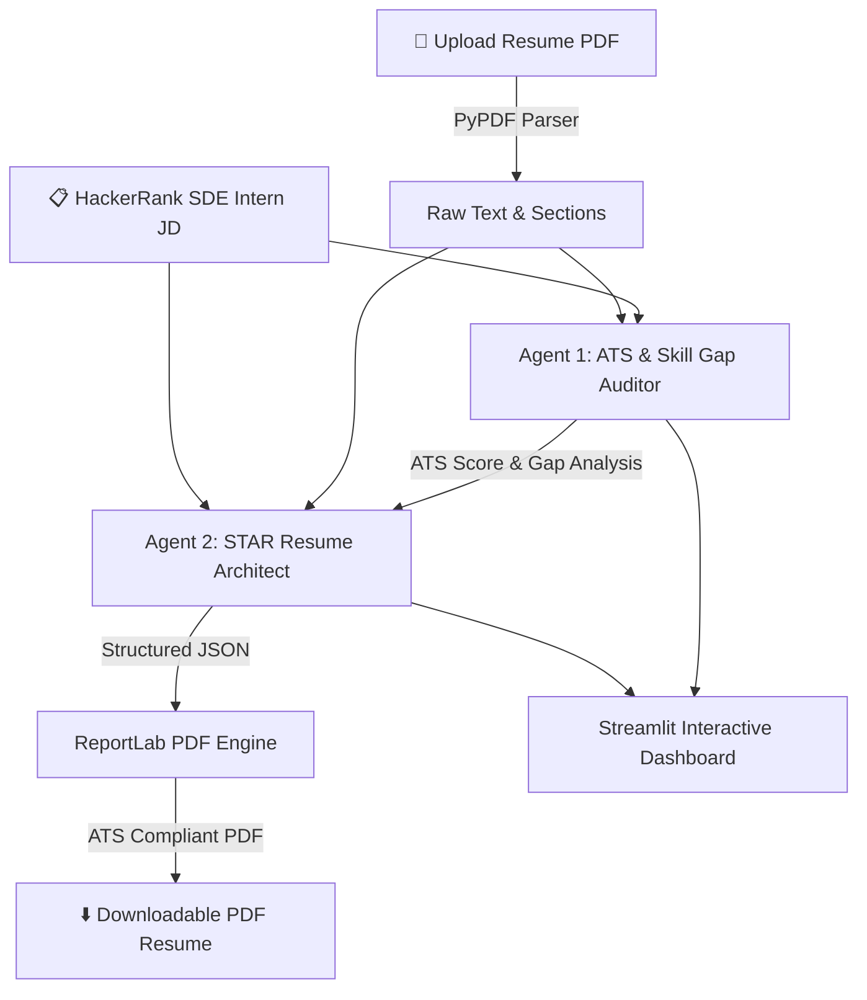

# ⚡ HackerRank AI Resume Architect & ATS Tailor

> **Multi-Agent Resume Optimization System** powered by **LangChain**, **Ollama (Local LLMs: Qwen 2.5 & Gemma 3)**, **PyPDF**, and **ReportLab**, custom-engineered for the **HackerRank SDE Intern Role** (*"Care about the craft"*, *"Humans & AI build side-by-side"*).


---

## 🌟 Overview

The **HackerRank AI Resume Architect** is a privacy-first, 100% local multi-agent system designed to optimize tech resumes for competitive software engineering positions. By pairing **PyPDF** text extraction with **LangChain** agent orchestration and **Ollama local LLMs**, the application conducts a deep ATS (Applicant Tracking System) audit and rewrites resume bullet points using the **STAR Method** (Situation, Task, Action, Result).

### 🎯 Key Highlights:
- **Zero Cloud API Dependencies:** Runs 100% locally via Ollama (`qwen2.5:latest` and `gemma3:4b`).
- **Dual AI Agent Pipeline:** Agent 1 (ATS Auditor) & Agent 2 (STAR Resume Architect).
- **Automated PyPDF Text Extraction:** Parses PDF resumes into structured sections seamlessly.
- **ATS-Compliant PDF Generation:** Compiles optimized content into a clean single-page PDF using ReportLab.
- **Interactive Streamlit Web Dashboard:** Modern dark-mode UI with live ATS gauges, side-by-side comparisons, and instant PDF download.

---

## 🏗️ Architecture & Workflow



---

## 🤖 The 2 AI Agents

### 📊 Agent 1: `ATS & Skill Gap Auditor` (`ats_analyzer_agent.py`)
* **Role:** Evaluates candidate resume text against the target Job Description.
* **LangChain Engine:** Uses `JsonOutputParser` + Pydantic schema validation over `ChatOllama`.
* **Output Metrics:**
  * **ATS Match Score (%)**: Overall compatibility percentage.
  * **Matched Skills**: Overlapping hard skills and frameworks.
  * **Missing Keywords**: Crucial tech stack & concepts missing from the candidate's profile.
  * **Weak Bullets**: Bullet points lacking metrics or STAR structure.
  * **HackerRank Values Alignment**: Checks for developer tool passion, clean code, and human+AI side-by-side building principles.

### 📝 Agent 2: `STAR Resume Architect` (`resume_tailor_agent.py`)
* **Role:** Rewrites and optimizes candidate experiences and project descriptions.
* **LangChain Engine:** Consumes candidate text + Agent 1 gap analysis to produce structured JSON data.
* **Optimization Highlights:**
  * Rewrites generic descriptions into high-impact STAR-format bullet points.
  * Weaves in missing keywords (e.g. *REST APIs, Automated Testing, Python/C++/Java, Git, Data Structures*) naturally.
  * Preserves truthful candidate experience while elevating technical impact metrics.

---

## 🛠️ Tech Stack & Dependencies

| Layer | Technology | Purpose |
| :--- | :--- | :--- |
| **Agent Framework** | [LangChain](https://www.langchain.com/) | Agent chaining, prompt templates, and structured Pydantic output parsing |
| **Local LLM Engine** | [Ollama](https://ollama.com/) | Privacy-preserving local LLM inference (`qwen2.5:latest` & `gemma3:4b`) |
| **PDF Extraction** | [PyPDF](https://pypdf.readthedocs.io/) | Extracting text streams from uploaded PDF resumes |
| **PDF Generation** | [ReportLab](https://www.reportlab.com/) | Rendering ATS-scannable single-page PDF resumes |
| **Web Dashboard** | [Streamlit](https://streamlit.io/) | Interactive web UI with real-time progress indicators |

---

## 🚀 Quickstart Guide

### 1. Prerequisites
Ensure you have Python 3.9+ installed and Ollama running locally:

```bash
# Verify Ollama installation & pull recommended model
ollama pull qwen2.5:latest
ollama pull gemma3:4b
```

### 2. Installation & Setup

```bash
# Clone the repository
git clone https://github.com/your-username/hackerrank-ai-resume-architect.git
cd hackerrank-ai-resume-architect

# Create and activate virtual environment
python3 -m venv venv
source venv/bin/activate

# Install dependencies
pip install -r requirements.txt
```

### 3. Run the Streamlit Application

```bash
streamlit run app.py
```

Open your browser and navigate to `http://localhost:8501`.

---

## 📁 Repository Structure

```
.
├── app.py                     # Streamlit Web Dashboard
├── ats_analyzer_agent.py      # Agent 1: ATS Auditor (LangChain + Ollama)
├── resume_tailor_agent.py     # Agent 2: Resume Architect (LangChain + Ollama)
├── pdf_parser.py              # PyPDF text extraction module
├── pdf_generator.py           # ReportLab ATS PDF generation engine
├── docs/                      # Documentation & Architecture diagrams
│   └── architecture.png       # High-resolution architecture flow diagram
├── requirements.txt           # Project Python dependencies
└── README.md                  # Project documentation
```

---

## 📜 License

MIT License © 2026 Karthik Vangapandu
