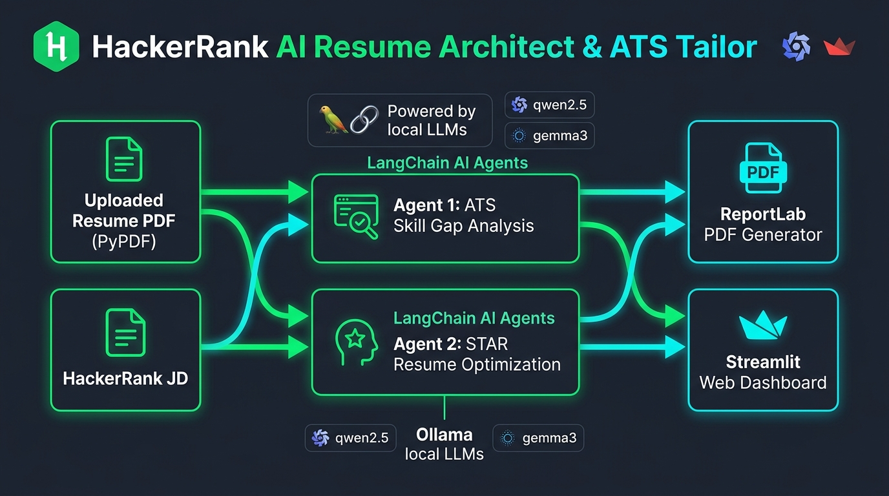

# AI Resume Architect

A local, privacy-first tool that tailors your resume to a job description. Upload a PDF resume, paste a JD, and get an ATS score plus a rewritten, ATS-friendly PDF.

Built with LangChain, Ollama (`qwen2.5` and `gemma3:4b`), PyPDF, ReportLab, and Streamlit. Everything runs on your machine, so your resume never leaves it.



---

## How it works

1. **Parse**: PyPDF extracts text from your resume.
2. **Audit**: Agent 1 scores your resume against the JD and lists matched skills, missing keywords, and weak bullets.
3. **Rewrite**: Agent 2 rewrites your bullets in STAR format, using the gaps found by Agent 1.
4. **Export**: ReportLab generates a clean single-page PDF you can download.

## Setup

You need Python 3.9+ and [Ollama](https://ollama.com/).

```bash
ollama pull qwen2.5:latest
ollama pull gemma3:4b

git clone https://github.com/your-username/ai-resume-architect.git
cd ai-resume-architect

python3 -m venv venv
source venv/bin/activate
pip install -r requirements.txt
```

## Run

```bash
streamlit run app.py
```

Then open http://localhost:8501.

## Project structure

```
.
├── app.py                  # Streamlit UI
├── ats_analyzer_agent.py   # Agent 1: ATS audit
├── resume_tailor_agent.py  # Agent 2: STAR rewrite
├── pdf_parser.py           # PDF text extraction
├── pdf_generator.py        # PDF output
├── requirements.txt
└── README.md
```
